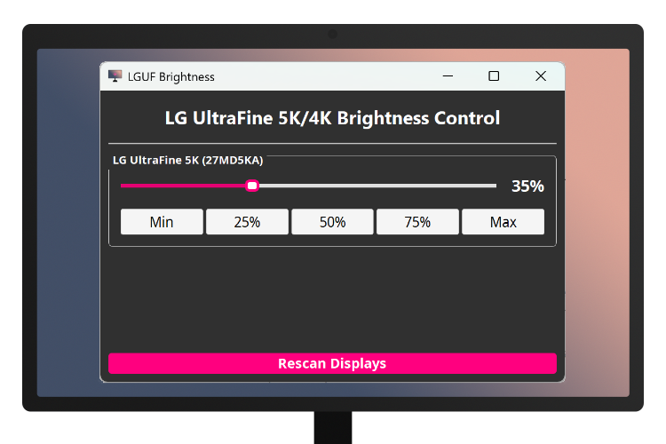

# LGUF Brightness



A Qt GUI utility for adjusting LG UltraFine 4K/5K monitor's brightness on Windows/Linux.

## Supported Models

| Model | USB Product ID |
|---|---|
| LG UltraFine 5K (27MD5KA) | 0x9a40 |
| LG UltraFine 5K (27MD5KL) | 0x9a70 |
| LG UltraFine 4K (24MD4KL) | 0x9a63 |

**Tested working on:** LG UltraFine 5K (27MD5KA) with Windows 11 / Debian 13.

## Features

- Intuitive GUI control panel with brightness control slider.

- Buttons for quickly controlling the brightness (with steps Min/25%/50%/75%/Max).

- Supports control of multiple LG UltraFine 5K/4K monitors' brightness.

## Build

### Dependencies

- **Qt 5.9 or newer** for the UI framework.

- **libusb-1.0** for USB-HID communication.

### Windows

1. Download *Latest Windows Binaries* of libusb from [libusb.info](https://libusb.info).

2. Create a directory `libusb` in the project's root directory, then copy `include`, `MinGW32` and `MinGW64` into `libusb`.

3. In Qt Creator, open `LGUFBrightness.pro`, then build and run the project.

### Linux

1. Install libusb-1.0 (e.g. using `sudo apt install libusb-1.0-0-dev` or `sudo dnf install libusb1-devel`)

2. Add these rules to `/etc/udev/rules.d/99-lg-ultrafine.rules`:

```
SUBSYSTEM=="usb", ATTR{idVendor}=="043e", ATTR{idProduct}=="9a40", MODE="0666", TAG+="uaccess"
SUBSYSTEM=="usb", ATTR{idVendor}=="043e", ATTR{idProduct}=="9a63", MODE="0666", TAG+="uaccess"
SUBSYSTEM=="usb", ATTR{idVendor}=="043e", ATTR{idProduct}=="9a70", MODE="0666", TAG+="uaccess"
```

3. In Qt Creator, open `LGUFBrightness.pro`, then build and run the project.

## Technical Details

**Build System:** qmake

**Compiler (Kit):** GCC/MinGW

**License:** [Apache License 2.0](LICENSE)

## Credits

*LG-ultrafine-brightness* by *ycsos*: https://github.com/ycsos/LG-ultrafine-brightness

*ubuntrafine* by *hanvv3*: https://github.com/hanvv3/ubuntrafine

*lg* by *chrisdavies*: https://github.com/chrisdavies/lg